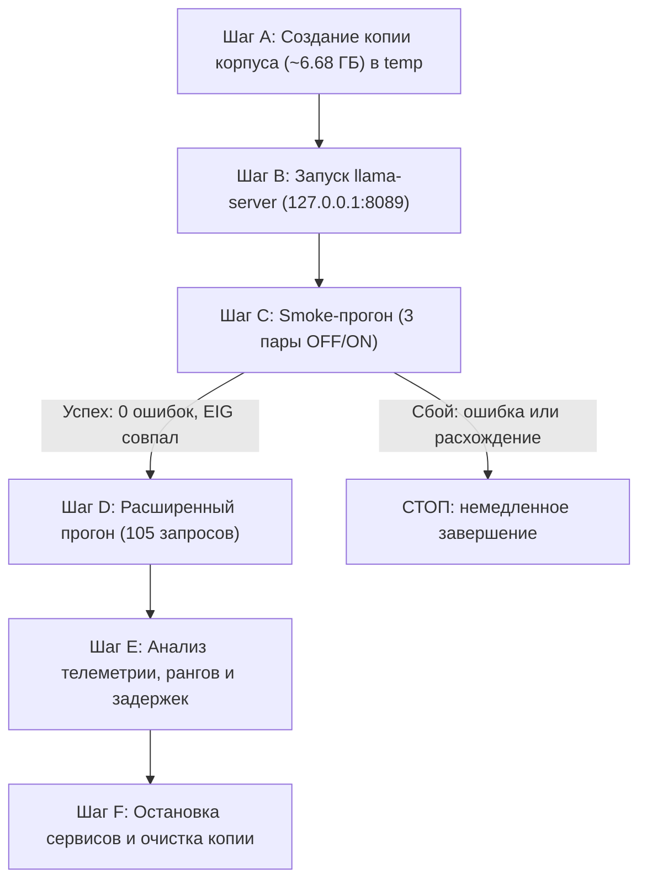

# FlyingRAG — Подготовка безопасного контура для реального ON/OFF-пилота (PILOT-PREP-01)
## Технический отчёт по заданию FR-TZ-20261116-005 / Revision 1

**Дата обследования**: 2026-11-16  
**Проект**: `Kritik35/flying-rag-mcp`  
**Рабочая ветка**: `audit/stage4-2-verification`  
**ТЗ**: `FR-TZ-20261116-005_PILOT_PREP_ccf0305b_FlyingRAG.txt`  
**Текущий статус**: **`STORAGE_PLAN: READY_FOR_APPROVAL / EMBEDDING_PROFILE: VERIFIED / AWAITING_OPERATOR_APPROVAL`**  

---

## 0. Исходные границы и цели задания

1. **Завершение цикла правок кода**: Узкое исправление Stage 4.2.8 Rev 4 / ERRATA-1 (коммит `ed0ac010c5739b4a08914063461780a58ca15e38`, отчёты `ccf0305bdf1ddc35836e0eb614251961998c986b`) полностью принято независимым рецензентом. Создание новых ERRATA, изменение guard, watcher, EIG или индексатора не требуются.
2. **Характер работы**: Задание является **операционной подготовкой** к реальному поисковому пилоту:
   - Провести инвентаризацию рабочих хранилищ и мест записи;
   - Рассчитать бюджет дискового пространства и предложить безопасный способ изоляции данных;
   - Проверить наличие и совместимость сервера инференса и модели эмбеддингов;
   - Подготовить точный сценарий запуска (smoke из 3 пар -> полный 105-запросный прогон);
   - Сформировать единую форму решения для согласования оператором.
3. **Строгие запреты**:
   - Изменение production-репозитория и production-БД категорически запрещено.
   - Запуск / остановка сервисов, загрузка модели в память, копирование многогигабайтного корпуса и выполнение поисковых запросов в рамках данного шага **НЕ производились** (`REAL_CORPUS_PILOT: NOT_EXECUTED`).

---

## 1. Шаг P0: Фиксация точки продолжения и доставка ТЗ

### 1.1. Состояние Git-репозитория
- **Ветка**: `audit/stage4-2-verification`
- **Протестированный коммит кода**: [`ed0ac010c5739b4a08914063461780a58ca15e38`](https://github.com/Kritik35/flying-rag-mcp/commit/ed0ac010c5739b4a08914063461780a58ca15e38) (Tree SHA: `699c2283219e4ab3d056ffd3b2a8510ebd5c04ca`)
- **Исходный отчётный коммит (HEAD)**: [`ccf0305bdf1ddc35836e0eb614251961998c986b`](https://github.com/Kritik35/flying-rag-mcp/commit/ccf0305bdf1ddc35836e0eb614251961998c986b) (Tree SHA: `a2d6d872ddbf232bd6156eeee53a36e83ef8c873`)
- **Baseline Anchor (Production)**: `9b498bf5dc09e964d035049a53582d52f13cdc95` (репозиторий чист, изменений нет)
- **Snapshot Anchor**: `4f43949aa9c03e7ccd99d1ce072d954f18f8c786`
- **Рабочая директория**: `working_tree_clean: True`

### 1.2. Подтверждение автоматической доставки ТЗ монитором
Штатная служба доставки `FlyingRAG_Drive_Inbox_Watcher` (Windows Task Scheduler, интервал 5 минут) успешно зафиксировала появление нового ТЗ:
- **Event ID**: `event_FR-TZ-20261116-005_PILOT_v1_920f8018`
- **Файл**: `FR-TZ-20261116-005_PILOT_PREP_ccf0305b_FlyingRAG.txt`
- **Размер**: `18,715 байт`
- **SHA256**: `920f8018213b853879bf5f9c8f8275ca3fd86fb20865e791fc14968cf504a6df`
- **Время фиксации**: `2026-11-16T14:45:02 UTC` (`17:45:02 MSK`)
- **Спул-копия**: `[AUDIT_ROOT]/rag_quality_ab_20261113/05_drive_watcher/inbox_spool/FR-TZ-20261116-005_PILOT_PREP_ccf0305b_FlyingRAG_v1_920f8018.txt`
- **Статус**: Автоматическая доставка подтверждена, повторный bootstrap не требовался.

---

## 2. Шаг P1: Инвентаризация хранилища и бюджет изоляции

### 2.1. Фактические компоненты производственного индекса
Анализ единой конфигурации `[REPO_ROOT]/config.yaml` и файловой системы выявил следующие целевые объекты хранения:

| Компонент | Расположение | Объём | Состояние / Особенности |
|:---|:---|:---:|:---|
| **SQLite Metadata DB** | `[CORPUS_DATA]/data_imported/metadata.db` | **1,485,103,104 байт** (~1.42 ГБ) | WAL: `0 байт`, SHM: `32,768 байт`. Sample SHA256: `9d1c73641bf2c882784756b4a09899662ad958af6b3f9e90c301f682fbc7fd85`. |
| **LanceDB Vector Store** | `[CORPUS_DATA]/data_imported/lancedb/` | **5,137,629,647 байт** (~4.90 ГБ) | 191 файл, таблица `documents_1024.lance`, контрактный манифест `index_manifest.json`. |
| **Table Parquet** | `[CORPUS_DATA]/data_imported/table_parquet/` | **54,970,671 байт** (~52.4 МБ) | Извлечённые таблицы нормативной документации. |
| **Итого корпус** | — | **~6,677,703,422 байт** (**~6.68 ГБ**) | Полный согласованный индекс нормативного корпуса. |

### 2.2. Аудит всех направлений записи (Write Destinations)
В ходе поискового цикла задействуются следующие пути:
1. **`metadata.db` (SQLite)**: В процессе поиска сервис FlyingRAG производит запись кэша запросов в таблицу `search_cache` (`INSERT/UPDATE`, 885 существующих записей). При включённом `semantic_cache` также происходит запись в таблицу `semantic_cache`. **Прямой запуск поиска по production-БД неизбежно вызывает операцию записи в файл `metadata.db`**, что подтверждает строгую необходимость физической изоляции.
2. **`lancedb/` (LanceDB)**: При выполнении поисковых запросов операции являются строго `read-only` (сканирование векторного индекса).
3. **Телеметрия EIG**: При работе асинхронного наблюдателя телеметрия пишется в выделенный файл канала `FLYING_RAG_SHADOW_EIG_LOG` (по умолчанию `eig_pilot_telemetry_<pair_id>.jsonl` в каталоге фикстуры).
4. **Временные файлы**: Создаются в системной директории temp для межпроцессного обмена дочерних воркеров.

### 2.3. Проверка существующих копий аудита (`00_inventory`)
В каталоге `[AUDIT_ROOT]/rag_quality_ab_20261113/00_inventory/` обнаружена изолированная копия:
- `metadata_isolated.db` (размер 1,485,103,104 байт, дата: 14.11.2026 16:55);
- `lancedb/` (размер 5,037,151,025 байт, 185 файлов).

**Критический результат проверки согласованности**:
- Sample SHA256 базы `metadata_isolated.db`: `ea3837f7c21c1606500e7253c6537f280d434a9e29d952e218ab150cd4e10b8d` **НЕ СОВПАДАЕТ** с актуальным хэшем production-БД `9d1c7364...`.
- Число файлов в `00_inventory/lancedb` составляет 185 файлов против 191 файла в production.
- **Вывод**: Копия в `00_inventory` представляет собой устаревший снимок этапа Stage 0 (до финализации индексатора). **Использовать её как актуальную реплику production-корпуса без синхронизации категорически нельзя.**

### 2.4. Бюджет свободного места на диске
- Диск размещения целевых данных: **Диск C:**
- Текущий свободный объём на C:: **`67,128,963,072 байт`** (**`62.52 ГБ`**).
- Необходимый объём для полной независимой копии: **`~6.68 ГБ`**.
- Прогнозируемый свободный остаток после создания копии: **`~55.84 ГБ`** (>89% текущего свободного пространства сохраняется).
- Ресурсный запас полностью подтверждён.

### 2.5. Сопоставление с принятым Pre-Execution Guard (Errata 1)
В соответствии с принятыми правилами Errata 1 (`tests/test_real_retrieval_shadow_pilot.py`):
1. Кандидатный корень хранилища обязан строго входить в `tempfile.gettempdir()`.
2. Выполнение на такой копии классифицируется оркестратором как `CONTRACT_SYNTHETIC` со скоупом `ISOLATED_COPY_VERIFIED`.
3. Для проведения испытания реального корпуса (`REAL_CORPUS_PILOT`) без нарушения политики временных каталогов рекомендуется:
   - Создать целевой каталог внутри `tempfile.gettempdir()` (например, `C:\Users\almax\AppData\Local\Temp\flying_rag_isolated_pilot_corpus\`);
   - Зарегистрировать данный каталог штатной функцией `register_verified_fixture_root()`;
   - Выполнить туда копирование `metadata.db` (1.42 ГБ), `lancedb` (4.90 ГБ) и `table_parquet` (52 МБ);
   - Это гарантирует, что guard пропустит выполнение без обхода правил и без единого риска для production.

---

## 3. Шаг P2: Профиль embeddings и подготовка запуска

### 3.1. Инвентаризация исполняемых файлов и модели
В ходе локального аудита обнаружены готовые компоненты апплаенса:

| Компонент | Локальный путь | Характеристики |
|:---|:---|:---|
| **Исполняемый сервер** | `C:\AI\release\v1\bin\llama-server.exe` | Версия: **`0.4.1-dev (build 11057, commit 044764e45)`**, MSVC 19.44 x64. Аппаратное ускорение: **OpenCL 1.1 / CLBlast FP32 (GeForce GT 540M, 1024 МБ VRAM)**. |
| **Файл модели** | `C:\AI\models\Qwen3-Embedding-0.6B-Q8_0.gguf` | Размер: **`639,150,592 байт`** (~609.5 МБ). Дата: 20.09.2026. Квантование: `Q8_0`. |

### 3.2. Сверка контракта индекса и размерности
1. В контрактном файле `[CORPUS_DATA]/data_imported/lancedb/index_manifest.json`:
   - `model`: `"Qwen3-Embedding-0.6B-GGUF"`;
   - `dimension`: **`1024`**;
   - `chunker`: `"parent-child-tiktoken-v1"` (cl100k_base, max_child=150, max_parent=1000).
2. В таблице `search_cache` базы `metadata.db`:
   - Извлечённые эмбеддинги векторизованы ровно в **`1024`** float-координаты.
3. В конфигурации `config.yaml`:
   - `model`: `Qwen3-Embedding-0.6B-Q8_0.gguf`;
   - `dimension`: `1024`.
- **Вывод**: Профиль модели и контракта индекса полностью совпадает (`EMBEDDING_PROFILE: VERIFIED`).

### 3.3. Немутирующий сетевой зонд порта 8089
Выполнен неблокирующий зонд сокета `127.0.0.1:8089`:
- Активные процессы `llama-server.exe`: **0** (отсутствуют);
- Сетевые соединения на порту 8089: **отсутствуют**;
- Результат подключения сокета с таймаутом 0.5 с: **`SOCKET_TIMEOUT`** (штатное поведение Windows Loopback при закрытом порте).
- Вердикт: **`BACKEND_STATE: SOCKET_TIMEOUT`**.

### 3.4. Подготовленная команда запуска (Предложение, статус: `NOT_EXECUTED`)
На основе проверенной производственной конфигурации `C:\AI\production\start_embedding_server.ps1` сформирована точная команда:

```powershell
# Запуск изолированного сервиса эмбеддингов (NOT_EXECUTED)
& "C:\AI\release\v1\bin\llama-server.exe" `
    -m "C:\AI\models\Qwen3-Embedding-0.6B-Q8_0.gguf" `
    -ngl 99 `
    -nkvo `
    -fa on `
    --embedding `
    -np 4 `
    -b 2048 `
    -ub 1024 `
    -t 2 `
    --host 127.0.0.1 `
    --port 8089 `
    --log-file "C:\AI\logs\embedding_server_pilot.log"
```

**Обоснование флагов**:
- `-ngl 99`: выгрузка всех слоёв на OpenCL GPU GeForce GT 540M;
- `-nkvo`: отключение KV-кэша (не требуется для модели эмбеддингов, экономит VRAM);
- `-fa on`: включение Flash Attention;
- `--embedding`: активация эндпоинта `/v1/embeddings`;
- `-np 4`: 4 параллельных слота инференса;
- `-b 2048 -ub 1024`: размер батча и микробатча для стабильной пакетной обработки;
- `-t 2`: ровно 2 физических потока CPU (соответствует 2 ядрам Core i3-2310M);
- `--host 127.0.0.1`: строгая привязка только к локальному loopback-интерфейсу;
- `--port 8089`: стандартный порт FlyingRAG.

**Команда остановки**:
```powershell
Stop-Process -Name "llama-server" -Force
```

---

## 4. Шаг P3: Сценарий проведения пилота (Runbook)

После получения отдельного согласования оператора пилот выполняется по следующему регламенту:



### Детальные этапы:
- **Этап A (Изоляция)**: Копирование `metadata.db` (1.42 ГБ), `lancedb` (4.90 ГБ) и `table_parquet` (52 МБ) в изолированный каталог `C:\Users\almax\AppData\Local\Temp\flying_rag_isolated_pilot_corpus\`. Регистрация каталога через `register_verified_fixture_root()`.
- **Этап B (Сервис эмбеддингов)**: Запуск `llama-server.exe` на `127.0.0.1:8089`. Немутирующая проверка `/health` (HTTP 200) и один тестовый запрос POST `/v1/embeddings` с проверкой размерности (1024).
- **Этап C (Smoke-тест, 3 пары OFF/ON)**:
  - 3 репрезентативных нормативных запроса;
  - Сквозной вызов реального поискового пайплайна MCP `_dispatch`;
  - Проверка реальных событий `ShadowEvidenceIntegrityGate` в dedicated jsonl;
  - Проверка отсутствия search errors и расхождений полезной нагрузки;
  - **Критерий перехода к Этапу D**: 100% PASS smoke-теста (3/3 пары).
- **Этап D (Расширенный прогон, 105 запросов)**:
  - 80 нормативных запросов (включая законные перекрёстные повторы) + 25 adversarial запросов;
  - Прямой мониторинг дельт счётчиков адаптера (`submitted`, `processed`, `errors`, `dropped`);
  - Измерение попарной задержки (paired latency) и разделение сырой и нормализованной эквивалентности.
- **Этап E (Отчётность)**: Формирование протокола с фиксацией перцентилей задержки ($p_{50}, p_{95}$), ранговой идентичности и доказательств неизменности production-файлов.
- **Этап F (Остановка)**: Завершение процесса `llama-server.exe`, удаление временной копии, публикация итогового отчёта в Git.

### Условия немедленной аварийной остановки (Fail-Closed Stop Triggers):
1. Недоказанный скоуп хранения или попытка обращения к production-путям;
2. Несовпадение размерности вектора эмбеддингов (`dim != 1024`);
3. Аварийное завершение или зависание дочернего поискового воркера;
4. Отсутствие или расхождение события EIG (`SHADOW_ERROR`, `EIG_EVENT_MISSING`);
5. Получение error-контейнера в поисковой выдаче;
6. Нормализованное расхождение результатов между режимами OFF и ON.

---

## 5. Официальные вердикты этапа

| Направление | Вердикт | Обоснование |
|:---|:---:|:---|
| **`STORAGE_PLAN`** | **`READY_FOR_APPROVAL`** | Инвентаризация завершена. Места записи определены (`search_cache` в SQLite). Бюджет диска (62.5 ГБ свободно) с запасом покрывает копию (~6.68 ГБ). План изоляции в зарегистрированном temp полностью согласован с guard Errata 1. |
| **`EMBEDDING_PROFILE`** | **`VERIFIED`** | Сервер `llama-server.exe` v0.4.1-dev и модель `Qwen3-Embedding-0.6B-Q8_0.gguf` найдены. Контракт индекса LanceDB (`index_manifest.json`) и кэш SQLite подтверждают размерность ровно 1024. |
| **`BACKEND_STATE`** | **`SOCKET_TIMEOUT`** | Порт 8089 закрыт, процессов `llama-server` нет, зонд вернул таймаут. Самовольный запуск не производился. |
| **`NEXT_EXECUTION`** | **`AWAITING_OPERATOR_APPROVAL`** | Все подготовительные действия выполнены. Ожидается решение оператора. |
| **`REAL_CORPUS_PILOT`** | **`NOT_EXECUTED`** | В рамках данного этапа поисковые вызовы не запускались. |
| **`PRODUCTION_DEPLOYMENT`** | **`NOT_AUTHORIZED`** | Production-репозиторий и production-хранилище строго read-only. |

---

## 6. Единая форма согласования для оператора

Для перехода к выполнению пилота оператору достаточно подтвердить следующую резолюцию:

> **«Разрешить создание независимой копии корпуса (~6.68 ГБ: SQLite 1.485 ГБ + LanceDB 5.138 ГБ + Table Parquet 0.055 ГБ) во временном каталоге `C:\Users\almax\AppData\Local\Temp\flying_rag_isolated_pilot_corpus\`, запуск `llama-server.exe` с моделью `Qwen3-Embedding-0.6B-Q8_0.gguf` на `127.0.0.1:8089` (loopback, 2 потока) и проведение начального smoke-теста из 3 реальных пар OFF/ON; рабочие файлы production `C:\RAG_Acer\data_imported\` не изменять; полный 105-запросный пилот выполнять только при 100% успехе smoke-теста.»**
